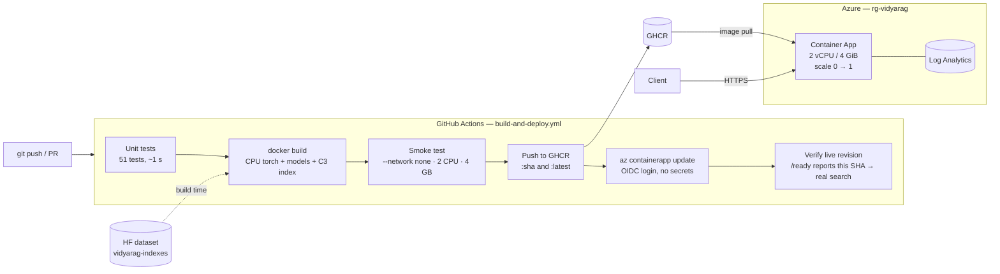

# Deployment

VidyaRAG's search API runs as a Docker container on **Azure Container Apps**. A
GitHub Actions pipeline tests, builds, ships and verifies every change on `main`.
The Streamlit UI is also hosted separately as a public demo on Hugging Face Spaces.

| Surface | Where | What it serves |
|---|---|---|
| REST API (production) | Azure Container Apps | FastAPI `/search` with BGE-large + C3 index, docs at `/docs` |
| Interactive demo | [Hugging Face Space](https://huggingface.co/spaces/SouravNath/vidyarag) | Streamlit UI |
| Container image | `ghcr.io/sourav-nath-01/vidyarag-api` | Immutable image, one tag per commit |

---

## Architecture



Pull requests run the same pipeline up to and including the smoke test, but
nothing is pushed or deployed.

---

## Design decisions

**Container Apps, not a VM or App Service.** The service needs about 3 GB of RAM
(BGE-large is 1.3 GB on its own), which rules out small App Service plans.
Container Apps runs any container image, gives an HTTPS endpoint, and can
**scale to zero**, so an idle demo costs almost nothing. The trade-off is a
cold start of about 1–2 minutes on the first request after idling: the image
pull plus loading the model into memory.

**Artifacts are baked into the image at build time.** `scripts/fetch_artifacts.py`
downloads the embedding model, the reranker and the C3 indexes during
`docker build`. At runtime the container sets `HF_HUB_OFFLINE=1` and never calls
out. Each image tag therefore pins an exact model and index set, cold starts
don't depend on a third-party download, and CI proves this by running the
smoke test with `--network none`.

**Memory budget → only the C3 strategy in production.** C3 is the best
configuration (MRR 0.826). Loading C1, C2 and C3 together would put peak memory
close to the 4 GiB limit. CI runs the container with `--memory 4g` and prints
actual usage after a search, so a regression fails the build instead of
production. To serve all three strategies, build with
`--build-arg INDEX_STRATEGIES=c1,c2,c3`.

**Smaller image.** The CPU-only PyTorch wheel avoids about 3 GB of CUDA
libraries. Layers are ordered from least to most frequently changed (OS deps,
Python deps, ~1.6 GB of model and index files, then app code), so a code
change rebuilds and pushes only a few KB. `.dockerignore` is an allowlist, so
the build context is about 176 KB instead of the multi-GB repo with `venv/`
and `data/`.

**Health model.**
- `GET /health` is the liveness probe. It returns 200 whenever the process is up.
- `GET /ready` is the readiness probe. It returns 200 only after warm-up has
  loaded the models and the default index, and reports the build SHA.
- Warm-up runs in FastAPI's lifespan hook, before Uvicorn opens the port, so
  the first user request never pays the model-loading cost.
- Container Apps has startup, readiness and liveness probes configured on
  these endpoints (`deploy/azure/setup.sh`).

**Back-pressure.** Search is CPU-bound, so concurrent searches only slow each
other down and multiply memory use. A semaphore allows `MAX_CONCURRENT_SEARCHES`
(default 2) at a time. Further requests wait up to 30 s, then get
`503 + Retry-After` instead of piling up until the container runs out of memory.

**Fail loudly on misconfiguration.** If an index was built with a different
embedding model than the one loaded, the API returns an explicit
`503 "index holds 1024-dim vectors but model produces 384-dim"`. Without the
check, FAISS fails with a bare `AssertionError`.

**Keyless deploys.** GitHub Actions authenticates to Azure with OpenID Connect.
A user-assigned managed identity trusts tokens issued only for this repo's
`production` environment, and holds `Contributor` on this resource group only.
No Azure password or key is stored in GitHub.

**Verifying the right revision.** After `az containerapp update`, the pipeline
polls `/ready` until it reports the commit SHA just deployed, then runs a real
search. A green deploy means the new code is live and answering, not just that
the old revision is still up.

**Security basics.** The container runs as non-root uid 1000. There are no
secrets in the image, and the Dockerfile `HEALTHCHECK` works under plain
`docker run` too.

---

## Running it yourself

```bash
# Build and run the production image locally (needs ~6 GB free disk)
docker build -f deploy/Dockerfile -t vidyarag-api .
docker run --rm -p 8000:7860 --memory 4g vidyarag-api
python deploy/smoke_test.py http://localhost:8000      # waits for /ready, runs a search

# Or without Docker, with the small demo index
EMBEDDING_MODEL=all-MiniLM-L6-v2 DEFAULT_STRATEGY=demo EMBEDDING_DEVICE=cpu \
  uvicorn api.app:app --port 8000
```

## First-time Azure setup

1. Merge to `main` once, so the pipeline pushes the image to GHCR. Then make
   the package public: GitHub → your profile → Packages → `vidyarag-api` →
   Package settings → Change visibility.
2. Open [Azure Cloud Shell](https://shell.azure.com) (Bash) and run:
   ```bash
   curl -fsSL https://raw.githubusercontent.com/Sourav-Nath-01/vidyarag/main/deploy/azure/setup.sh | bash
   ```
3. Run the `gh secret set` / `gh variable set` commands the script prints.
   From then on, every merge to `main` deploys automatically.

## Operations

| Task | Command |
|---|---|
| Live logs | `az containerapp logs show -n vidyarag-api -g rg-vidyarag --follow` |
| Revisions (history) | `az containerapp revision list -n vidyarag-api -g rg-vidyarag -o table` |
| Roll back | `az containerapp update -n vidyarag-api -g rg-vidyarag --image ghcr.io/sourav-nath-01/vidyarag-api:<previous-sha>` |
| Keep warm (e.g. before a demo) | `az containerapp update -n vidyarag-api -g rg-vidyarag --min-replicas 1` (set back to `0` afterwards, since it bills while idle) |
| Tear everything down | `az group delete -n rg-vidyarag --yes` |

**Cost.** With `minReplicas: 0` you pay only while a request is being handled
(plus a ~5-minute cool-down), and light demo traffic should stay within
Container Apps' monthly free allowance. `maxReplicas: 1` puts a hard ceiling
on spend. GHCR and GitHub Actions are free for public repositories.
